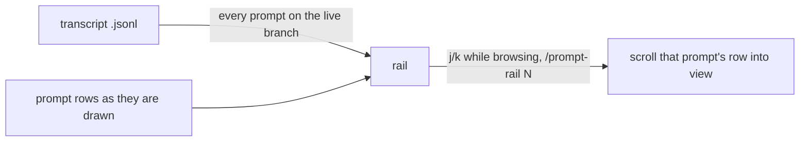

<div align="center">

# prompt-rail

The latest prompt of your Claude Code session above the prompt. Press alt+j to browse your prompts by keyboard.


</div>

A fork of [oikon48/prompt-rail](https://github.com/oikon48/prompt-rail) that keeps one layout, modeled on the oh-my-pi prompt rail.

```
❯ #7 ship it                          <- at rest: one row, tinted like your prompts in the transcript

╭──────────────────────────────╮      <- alt+j: browsing
│   #4 fix the flaky test      │
│   #5 now the docs            │
│ ❯ #6 and the changelog       │
│   #7 ship it                 │
╰──────────────────────────────╯
 j: next  k: prev  q: back
```

At rest the band above the prompt holds the latest prompt on one row. Alt+j starts browsing at the latest prompt: `j` and `k` move to the next and previous prompt and scroll the transcript to it, and `q` or Escape returns to the prompt. The rail takes no mouse input.

## Quick start

1. Turn on function hooks (early access, Claude Code 2.1.280+) in `~/.claude/settings.json`:

   ```json
   { "env": { "CLAUDE_CODE_ENABLE_FUNCTION_HOOKS": "1" } }
   ```

2. Install, from your shell or inside a session:

   ```bash
   claude plugin marketplace add 1orZero/prompt-rail
   claude plugin install prompt-rail@1orzero
   ```

   ```
   /plugin marketplace add 1orZero/prompt-rail
   /plugin install prompt-rail@1orzero
   ```

3. Bind the keys in `~/.claude/keybindings.json`. Alt+j gives the band the keyboard, which starts browsing, and Escape there ends it:

   ```json
   {
     "bindings": [
       { "context": "Chat", "bindings": { "meta+j": "abovePrompt:focus" } },
       { "context": "AbovePrompt", "bindings": { "escape": "command:prompt-rail-back" } }
     ]
   }
   ```

   In a terminal `alt` and `meta` are the same key. Without the bindings, `ctrl+x tab` starts browsing and `q` ends it.

4. Start a new session. The rail shows once you send a prompt.

## Commands

| Command | |
| --- | --- |
| `/prompt-rail` | Show or hide the rail |
| `/prompt-rail on`, `off` | Show or hide the rail |
| `/prompt-rail 12`, `#12` | Jump to prompt #12 |
| `/prompt-rail first`, `last` | Jump to the first or the newest prompt |
| `/prompt-rail find <words>` | Jump to the newest prompt that holds the words |
| `/prompt-rail-back` | Stop browsing, for the Escape binding |

On or off is also the "Prompt rail" row in `/config`, and it is kept across sessions.

## How it works

<details>
<summary>From the transcript file to the rail</summary>



The rail lists the prompts of the live branch, so prompts abandoned with `/rewind` drop out, and prompts from before a resume are listed too. The transcript is read again only when its size or time changed.

</details>

## Limitations

<details>
<summary>Known limits</summary>

- Function hooks are early access, and their API may change between Claude Code releases.
- The Claude desktop app gives a plugin no way to scroll its transcript, so a jump cannot land there; the rail says so once a session.
- A `/compact` command's own row cannot be jumped to.
- Claude Code gives a plugin no fullscreen view, so browsing scrolls the transcript itself rather than opening a replay.
- The Escape binding applies wherever the band holds the keys; with it, Escape leaves another plugin's band only when the rail's row holds the ring.

</details>

## Development

```bash
claude --plugin-dir plugins/prompt-rail        # load this checkout; saving reloads it
claude plugin validate plugins/prompt-rail
claude plugin test plugins/prompt-rail
```

Run `/plugin-types .claude/types` in a session here for type declarations. Bump the version in `plugins/prompt-rail/.claude-plugin/plugin.json` with each release, since installed copies update only when it changes.

## License

[MIT](LICENSE)
